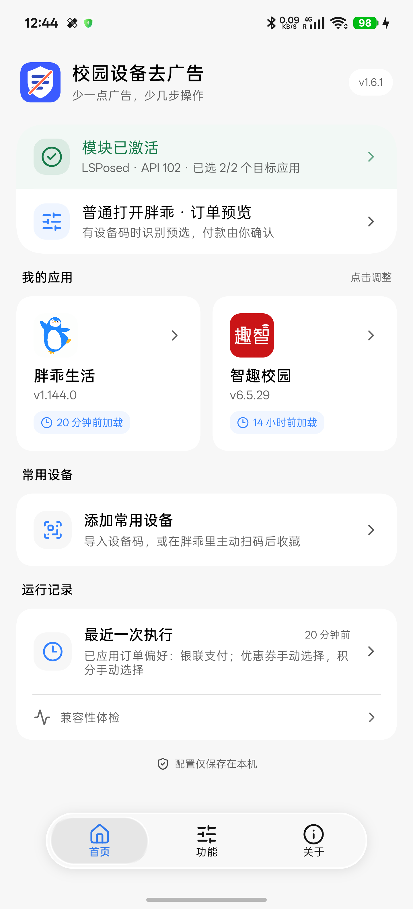
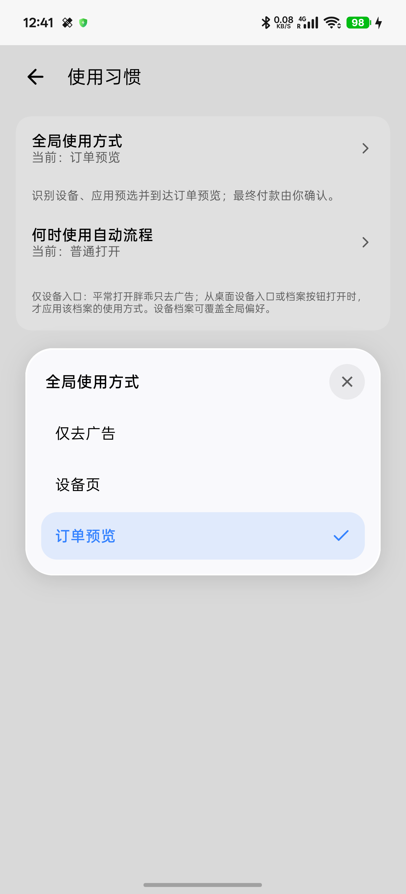
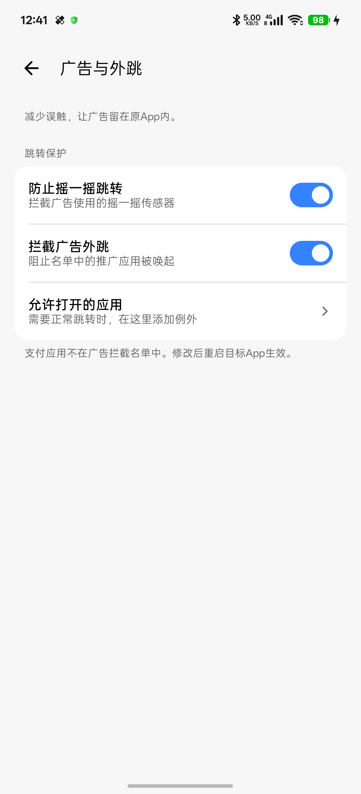
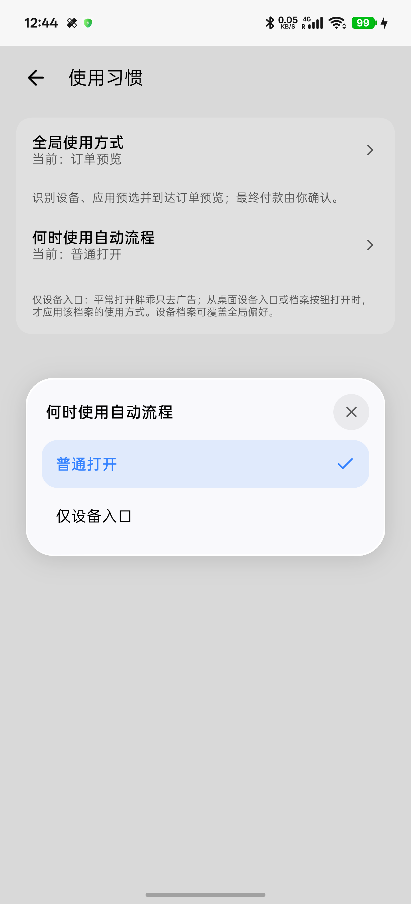
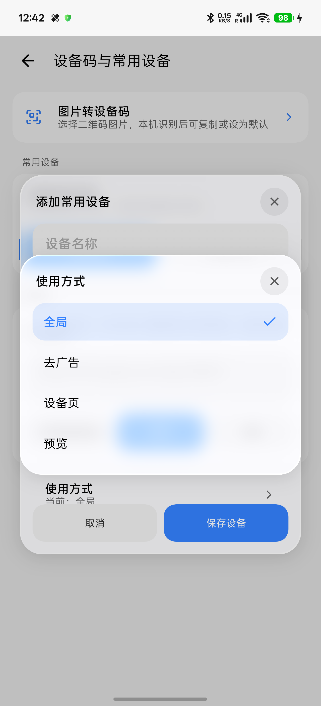
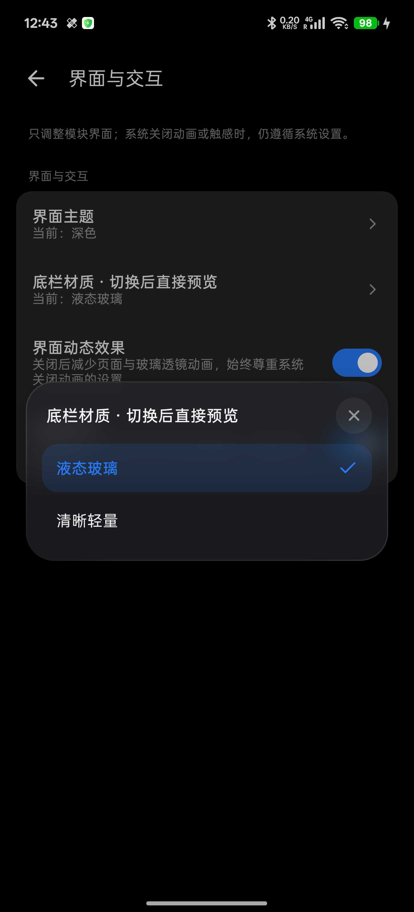

<div align="center">
  
  <h1>校园设备去广告</h1>
  <p>Campus AdBlock</p>
  <p><strong>少一点广告，少几步操作。</strong></p>
  <p>一个模块 · 两个 App · 本地运行 · 使用方式由你决定</p>
  <p>
    <a href="#下载"></a>
    <a href="#适配范围"></a>
    <a href="LICENSE"></a>
  </p>
  <p>
    
    
  </p>
  <p>
    <a href="#下载">下载 APK</a> ·
    <a href="#界面预览">界面预览</a> ·
    <a href="#开始使用">开始使用</a> ·
    <a href="docs/usage.md">使用指南</a> ·
    <a href="docs/build.md">源码构建</a> ·
    <a href="CHANGELOG.md">更新记录</a>
  </p>
</div>

> 当前版本 **v1.6.2 / versionCode 25**。下方界面截图保留 v1.6.1 历史预览；使用习惯现已简化为一个开关。

## 项目简介

**校园设备去广告**是面向胖乖生活、智趣校园独立 App 的 LSPosed 模块。清理已匹配的开屏、横幅、信息流和弹窗广告，减少摇一摇与推广外跳，并提供可选的设备识别和参数预选。

在“功能 → 使用习惯”中，一个开关控制自动流程：开启直达订单预览，关闭仅去广告、自己操作。v1.6.2 已移除报价核对和连续失败暂停的阻断。**最终付款由你确认，模块不代付、不创建订单、不启动设备。**

设置界面使用 Miuix 与 Jetpack Compose，提供实时玻璃底栏、紧凑选择面板和轻微回弹；设备码识别、收藏、配置与运行摘要在本机处理。目标 App 的设备查询、登录和支付仍由原 App 完成。

## 界面预览

以下均为 **v1.6.1** 真机截图。截图中的加载时间与运行摘要表示当时的历史记录。

<table align="center">
  <tr>
    <td align="center" width="33%">
      
      <p><strong>首页 · 状态总览</strong></p>
    </td>
    <td align="center" width="33%">
      
      <p><strong>使用习惯 · 三种方式</strong></p>
    </td>
    <td align="center" width="33%">
      
      <p><strong>广告外跳 · 简化规则</strong></p>
    </td>
  </tr>
  <tr>
    <td align="center" width="33%">
      
      <p><strong>玻璃菜单 · 清晰选择</strong></p>
    </td>
    <td align="center" width="33%">
      
      <p><strong>设备档案 · 独立偏好</strong></p>
    </td>
    <td align="center" width="33%">
      
      <p><strong>深色模式 · 玻璃材质</strong></p>
    </td>
  </tr>
</table>

## 功能特性

| 功能 | 说明 |
| --- | --- |
| 双应用去广告 | 清理胖乖生活、智趣校园中已匹配的广告位、开屏和弹窗 |
| 广告外跳保护 | 防止广告摇一摇，拦截名单内的推广外跳；可按应用设置例外 |
| 三种使用方式 | 仅去广告、停在设备页、直达订单预览；普通打开与独立设备入口可分别使用 |
| 无取景框直达 | 有可用设备码时直接识别设备，自动流程不进入扫码取景框；失败时保留手动操作 |
| 常用设备档案 | 收藏、分组、排序、独立偏好与桌面设备入口，未独立设置的项目跟随全局 |
| 图片转设备码 | 从系统文件选择器导入二维码图片，本机识别后复制、收藏或设为默认 |
| 参数预选 | 按偏好选择机号、档位与可用支付方式；优惠券、积分是否自动选择可分别设置 |
| 自动流程保护 | 连续识别失败后暂停；检测到报价或档位变化时停下，供你核对 |
| 状态与诊断 | 分开显示框架连接、目标进程加载与具体执行记录，支持复制脱敏诊断 |
| 配置备份 | 本地导入导出，导入前确认；设备码默认不导出 |
| 界面与交互 | 真实 Miuix 组件、深浅色、玻璃材质、拖动切页与轻微回弹，遵循动画和触感设置 |

## 下载

**首个公开版本：v1.6.1。** [下载正式 APK](https://github.com/dx101625/campus-adblock/releases/download/v1.6.1/campus-adblock-v1.6.2.apk) · [发布说明、源码与 SHA-256](https://github.com/dx101625/campus-adblock/releases/tag/v1.6.2)。

发布包使用项目原签名，后续版本可覆盖升级。GitHub Actions 的构建产物是供开发检查的未签名包，与正式发布包分开。

## 开始使用

### 准备环境

- 已配置 Root 与支持 **modern libxposed API 102** 的 LSPosed 或兼容框架；KernelSU / Magisk 本身不代替模块框架。
- 已安装胖乖生活或智趣校园独立 App，并在原 App 中完成登录。
- 支持情况以[适配范围](#适配范围)为准。

### 启用模块

1. 安装正式 APK，在框架管理器中启用“校园设备去广告”。
2. 作用域勾选你要使用的胖乖生活和/或智趣校园。
3. 打开模块首页，检查框架连接与作用域；“已激活”和应用卡片上的“上次加载”是不同状态。
4. 在“功能 → 使用习惯”选择自己的方式，再完全退出并重开目标 App。
5. 需要自动设备流程时，在“设备码与常用设备”导入二维码图片、粘贴设备码，或先在胖乖中主动扫码一次。

| 使用方式 | 模块做什么 | 接下来由你操作 |
| --- | --- | --- |
| 仅去广告 | 清理已匹配的广告，普通打开不执行设备识别、预选或推进 | 扫码、选机、选档与支付 |
| 设备页 | 识别设备并按偏好预选，停在设备页 | 核对参数，手动继续 |
| 订单预览 | 识别设备并应用偏好，推进到订单预览 | 核对金额与选项，确认付款 |

**第一次使用：** 模块不预置设备码。默认开启去广告、开屏跳过和广告外跳保护；胖乖默认方式为订单预览、普通打开，有可用设备码后才执行自动流程。默认机号为右边 2 号、档位最短、支付偏好银联，优惠券和积分不自动选择。没有设备码时保留原 App 流程；喜欢手动操作可先切到“仅去广告”。

“仅设备入口”适合平时手动、偶尔直达的习惯：普通打开胖乖只去广告；主动点击档案或桌面入口时，按对应设备档案执行。详情见[使用指南](docs/usage.md)。

## 适配范围

| 项目 | 已验证或声明范围 |
| --- | --- |
| 胖乖生活 | 1.144.0 / versionCode 294，`com.qiekj.user` |
| 智趣校园 | 6.5.29，`com.klcxkj.zqxy` |
| 设备与框架实测 | PJZ110 · Android 17 / API 37 · LSPosed 2.2.1 / API 102 |
| 系统声明 | minSdk 24 / Android 7.0，targetSdk 34；不代表各系统版本均已实测 |
| 设备自动流程 | 当前真机验证的是胖乖吹风设备页；其他设备类型先使用手动操作 |

v1.6.1 完成模块界面检查与 29 项单元测试，并在原手机验证胖乖三种使用方式、无扫码中间页及相机访问不增加。另在 Android 7 / API24 与 Android 15 / API35 独立模拟器完成原签名 APK 全新安装、未连接框架提示、空设备码、默认方式与设置持久化检查；模拟器不用于证明目标 App 的 Hook 兼容性。智趣本轮确认模块加载与开屏跳过，因未登录跳过登录后页面；商城隐藏曾在 v1.6.0 验证。详见[验证记录](docs/validation.md)。

目标 App 更新后可能需要重新适配，未验证的胖乖版本会暂停自动直达。设备档案中的洗衣、饮水等图标用于分类，不代表相应自动流程已经验证。模块作用于独立 App，不覆盖微信或支付宝里的小程序。

玻璃效果按系统能力与界面偏好降级；Android 7 不提供新增的框架状态服务。更多说明见[适配与验证](docs/compatibility.md)和[激活状态说明](docs/activation.md)。

## 源码构建

构建环境使用 JDK 21、Gradle 9.7.1 与 Android SDK / Build Tools 37.0。业务 Hook 为 Java 17，界面为 Kotlin / Compose。准备步骤与可覆盖的工具链路径见[构建指南](docs/build.md)。

```shell
# 准备好工具链后，构建供开发检查的未签名包
python build.py --no-sign

# 项目维护者使用原签名材料构建正式包
python build.py
```

签名文件、口令、本机配置和设备数据不随源码发布。正式包构建在缺少原密钥时会停止；本地已有依赖缓存时可加 `--offline`。自动构建配置见 [build.yml](.github/workflows/build.yml)，远端运行结果以 GitHub Actions 实际记录为准。

## 帮助与反馈

- 使用问题先查看[使用指南](docs/usage.md)与[适配范围](docs/compatibility.md)。
- 反馈时附上系统、框架、模块及目标 App 版本，说明使用方式、复现步骤和实际结果，可使用 [GitHub Issues](https://github.com/dx101625/campus-adblock/issues)。
- 运行详情可复制脱敏诊断；提交前请核对文字与截图，移除设备码、手机号、账号、订单及支付信息。
- 模块自身不联网、不上传配置；打开 GitHub 链接、原 App 查询设备和付款使用对应应用的能力。数据说明见 [SECURITY.md](SECURITY.md)。

## 文档导航

| 文档 | 内容 |
| --- | --- |
| [使用指南](docs/usage.md) | 使用习惯、设备档案、图片识码、备份与常见问题 |
| [适配与验证](docs/compatibility.md) | 支持基准、实测范围与限制 |
| [验证记录](docs/validation.md) | 真机流程、独立首装与构建检查的具体范围 |
| [激活状态](docs/activation.md) | 框架实时连接与历史加载记录的区别 |
| [配置说明](docs/config.md) | 配置键、默认值与备份格式 |
| [源码构建](docs/build.md) | 工具链、签名与构建方法 |
| [工作原理](docs/how-it-works.md) | 广告匹配与自动流程实现 |
| [更新记录](CHANGELOG.md) | 各版本变化 |
| [参与贡献](CONTRIBUTING.md) | 规则修改、问题复现与提交约定 |

## 开源协议与致谢

本项目使用 [MIT License](LICENSE)。感谢以下开源项目：

- [Miuix](https://github.com/compose-miuix-ui/miuix)：HyperOS 风格的原生 Compose 组件。
- [Backdrop](https://github.com/Kyant0/AndroidLiquidGlass) 与 [Shapes](https://github.com/Kyant0/Shapes)：实时玻璃模糊、折射、高光与形状计算。
- [libxposed](https://github.com/libxposed)：模块接口与框架状态服务。
- [AndroidX / Compose](https://github.com/androidx/androidx)、[Kotlin](https://github.com/JetBrains/kotlin) 与 [kotlinx.coroutines](https://github.com/Kotlin/kotlinx.coroutines)：界面与运行支持。
- [Lucide](https://github.com/lucide-icons/lucide) 与 [GitHub Octicons](https://github.com/primer/octicons)：界面图标。
- [ZXing](https://github.com/zxing/zxing)：本地二维码图片识别。

第三方组件保留各自许可，完整文本见 [licenses](app/src/main/assets/licenses)，也可在应用内“关于 → 引用与许可”阅读。图标来源与再生成方法见[图标说明](docs/icons.md)。

README 的居中介绍、徽章与截图表格排版参考 [AstrBot for Android](https://github.com/JunWan666/astrbot-for-android)；文字、项目图标与界面截图来自本项目。

本项目为非官方工具，与目标 App 的开发者无关联。模块按当前已匹配规则工作，目标 App 版本、设备类型和框架变化都可能影响效果。
